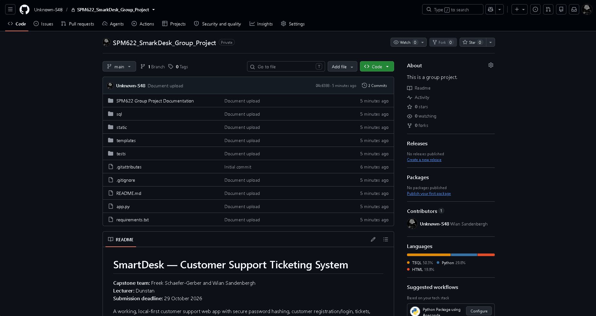

Project: SmartDesk: A Customer Support Ticketing System for Small IT Support Teams
Group: Freek Schaefer-Gerber, Wian Sandenbergh

# 1. Repository URL
**Link:** https://github.com/Unknown-S48/SPM622_SmarkDesk_Group_Project

# 2. README
A complete `README.md` is included in the root directory of the repository. It details the project description, technology stack (Python/Flask/SQLite), setup instructions, and the demonstration login credentials.

# 3. Repository Overview & Commit History
The project's source code, database scripts, templates, and complete documentation have been uploaded to the GitHub repository. The repository structure includes directories for documentation, SQL schemas, static files, templates, and automated tests.

**Commit History:**
The repository shows the upload of the final project files and documentation.

# 4. Project Structure & Collaboration
The repository contains the following key components:
* `SPM622 Group Project Documentation` (All chapters and final dissertation files)
* `sql` (Database schema)
* `static` & `templates` (Frontend UI)
* `tests` (Automated pytest suites)
* `app.py` (Main Flask application)

*(Note: The repository indicates contributions from the team member account `Unknown-S48` / Wian Sandenbergh).*